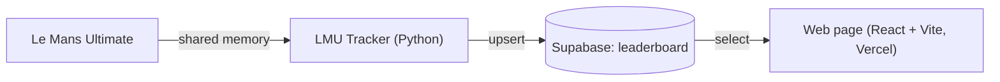

# LMU Tracker 🏎️

A Windows tracker for **Le Mans Ultimate** that reads live telemetry from the game, calculates the **average time of your last five clean laps** and uploads your best result to an online leaderboard.

This is the data-collection half of the project. The results are displayed by the web page **[LMU_tracker_page](https://github.com/FilipKLGAOlczyk/LMU_tracker_page)** ([live demo](https://lmu-leaderboard-page.vercel.app)).

> Unofficial fan project, not affiliated with the developers of Le Mans Ultimate.

## How it works



1. The app waits until the game process is running, then connects to its telemetry.
2. It checks every 50 ms whether you have completed a lap.
3. A lap counts only if it is **clean**: not invalidated by the game and not driven through the pit lane. An invalid lap resets the series.
4. After five clean laps in a row it calculates the average of the last five.
5. If this average beats your best one from the current run, it saves the driver name, track, car class, car and time (formatted as `m:ss:mmm`) to the `leaderboard` table in Supabase.

## Requirements

- Windows with Le Mans Ultimate installed
- Python 3
- A [Supabase](https://supabase.com) project with a `leaderboard` table
- Python packages: `python-dotenv`, `supabase`
- The `pyLMUSharedMemory` module (included in this repository) for reading the game's shared memory

## Setup

```bash
git clone https://github.com/FilipKLGAOlczyk/lmu_tracker_app.git
cd lmu_tracker_app
pip install python-dotenv supabase
```

Create a `.env` file in the project folder (it must not be committed):

```
supabase_url=https://<your-project>.supabase.co
supabase_key=<your-anon-key>
```

Use the **anon** key, never the `service_role` key, and protect the table with Row Level Security.

## Usage

```bash
python app.py
```

Start it before or after launching the game – it waits for Le Mans Ultimate and then tracks your laps automatically.

## Database

Table `leaderboard`:

| Column | Description |
|---|---|
| `name` | Driver name |
| `track` | Track name |
| `class` | Car class |
| `car` | Car name |
| `avg_five` | Average of the last five clean laps, formatted as `m:ss:mmm` |

## Possible improvements

- Keep the best average per track/car combination instead of a single value per run.
- Compare with the result already stored in the database before overwriting it (ideally server-side).
- Store lap times as numbers and format them only in the UI.

## Credits

Telemetry access is based on the `pyLMUSharedMemory` module included in this repository.
