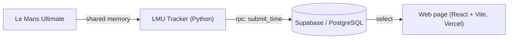

# LMU Tracker 🏎️

A Windows tracker for **Le Mans Ultimate** that reads live telemetry from the game, calculates the **average time of your last five clean laps** and uploads your best result for each track and car to an online leaderboard.

This is the data-collection half of the project. The results are displayed by the web page **[LMU_tracker_page](https://github.com/FilipKLGAOlczyk/LMU_tracker_page)** ([live demo](https://lmu-leaderboard-page.vercel.app)).

> Unofficial fan project, not affiliated with the developers of Le Mans Ultimate.

## How it works



1. The app waits until the game process is running (checked with `psutil`) and connects to its shared memory, retrying while the game is still loading. When the game is closed, it goes back to waiting.
2. It reads the telemetry every 50 ms and detects when you complete a lap.
3. A lap counts only if it is **clean**: not invalidated by the game and not driven through the pit lane. An invalid lap resets the series. The first lap after the app connects (usually the out-lap) is ignored.
4. The last five clean laps in a row form a series. The series restarts automatically when a new session starts (the lap counter drops) or when the track, car class or car changes.
5. When the average of the series beats the best one sent during this run for the same driver, track, class and car, the app calls the `submit_time` function in the database.
6. **The database decides** whether the result is a new record: it saves the time only if it is better than the stored one. Restarting the app or driving on another computer can never overwrite a better time.
7. If the network request fails, the result is sent again after the next lap.

## Requirements

- Windows with Le Mans Ultimate installed
- Python 3
- A [Supabase](https://supabase.com) project
- Python packages from `requirements.txt` (`python-dotenv`, `supabase`, `psutil`)
- The `pyLMUSharedMemory` module (included in this repository) for reading the game's shared memory

## Setup

### 1. Install

```bash
git clone https://github.com/FilipKLGAOlczyk/lmu_tracker_app.git
cd lmu_tracker_app
pip install -r requirements.txt
```

### 2. Prepare the database

If you start with an empty Supabase project, create the table first:

```sql
create table leaderboard (
  id bigint generated always as identity primary key,
  name text not null,
  track text not null,
  class text not null,
  car text not null,
  avg_five text,
  avg_five_s double precision
);
```

Then run [`supabase_setup.sql`](supabase_setup.sql) in the Supabase SQL Editor, step by step. The script:

- adds the numeric time column `avg_five_s` (and fills it from existing `avg_five` values),
- removes duplicate rows, keeping the best time for each driver/track/class/car,
- adds a unique constraint on `(name, track, class, car)`,
- creates the `submit_time` function,
- turns on Row Level Security with public read-only access.

If the table already has insert or update policies, remove them (the script shows how to list them), otherwise anyone with the public key could still write to the table directly.

### 3. Configure

Create a `.env` file in the project folder (it must not be committed):

```
supabase_url=https://<your-project>.supabase.co
supabase_key=<your-anon-key>
```

Use the **anon** key, never the `service_role` key. The anon key is enough, because results are written only through `submit_time`.

## Usage

```bash
python app.py
```

Start it before or after launching the game. It waits for Le Mans Ultimate and then tracks your laps automatically.

## Database

Table `leaderboard` (one row per driver, track, class and car):

| Column | Description |
|---|---|
| `name` | Driver name |
| `track` | Track name |
| `class` | Car class |
| `car` | Car name |
| `avg_five` | Average of the last five clean laps as text (`m:ss:mmm`), used for display |
| `avg_five_s` | The same average in seconds, used for comparing and sorting |

Function `submit_time(p_name, p_track, p_class, p_car, p_avg_s, p_avg_text)` returns `true` if the result was saved as a new best and `false` otherwise. It rejects lap averages outside 20–1800 seconds and overly long names.

Anyone who has the public key can still call `submit_time` with made-up times. That is fine for a leaderboard among friends; for a public one, add authentication.

## Windows executable (optional)

```bash
pip install pyinstaller
pyinstaller --onedir --noupx --name LMUTracker app.py
```

Folder mode (`--onedir`) without UPX is less likely to be flagged by antivirus software than a single-file build, but false positives are still possible with PyInstaller programs. Put the `.env` file in the folder you start the executable from.

## Ideas for the future

- Authentication, so that results cannot be spoofed.
- Autostart with Windows and a tray icon.
- Lap comparison and telemetry charts on the web page.

## Credits

Telemetry access is based on the `pyLMUSharedMemory` module included in this repository.
